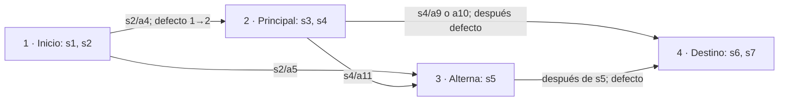

# Análisis de integración del recorrido visual con el motor

Proyecto Life Drive · Unity 6000.6.7f1 · rama feat/unity-map.

**Alcance: inspección estática y documentación. No se implementa integración.** Las conclusiones describen los archivos presentes en este checkout, no garantizan el estado de otros equipos o ramas. No se inició una partida, no se invocó Sesion.Juego y no se escribió en la base de datos del jugador.

## Diagnóstico principal

El movimiento y las transiciones son reutilizables como presentación. **No existe actualmente una correspondencia confirmada entre los IDs numéricos del motor y los 16 IDs visuales.** Las 16 asociaciones de CatalogoMapas.asset conservan tramoId, situacionId y alternativaId en cero.

El motor tiene cuatro tramos, siete situaciones y veinte alternativas. Produce tres secuencias de tramos posibles, con convergencia de caminos. El árbol visual tiene dieciséis fondos, ocho secuencias de cinco fondos y no converge hasta DELIVERY. Las respuestas actuales no seleccionan inequívocamente las tres bifurcaciones binarias visuales. Integrar los ocho recorridos educativos requiere acordar contenido y una política de asociación; no basta con conectar un campo tramo_actual_id al catálogo.

ServicioPartidas confirma la decisión, aplica sus efectos y avanza el estado lógico **antes de devolver** ResultadoDecision. La animación debe representar después un hecho ya confirmado, sin ejecutar otra decisión ni retrasar la transacción hasta que llegue el camión.

## Fuentes inspeccionadas

- Motor/ServicioJuego.cs, ServicioPartidas.cs, Evaluacion.cs y Sesion.cs.
- UI/PantallaPartida.cs y, para completar el flujo, PantallaInicio.cs, PantallaRegistro.cs, PantallaResultado.cs y BotonesLista.cs.
- StreamingAssets/Contenido/ruta.json completo.
- Mapas/Demo/DemoRecorrido.cs, RecorridoDemo.cs y RecorridosVisualesDemo.cs; Mapas/CatalogoMapas.cs y Mapas/CatalogoMapas.asset.
- Datos/Contenido.cs, Registros.cs y BaseDatos.cs; Motor/ServicioDesempeno.cs, ServicioUsuarios.cs y RegistroEventos.cs.
- Inventario de escenas, EditorBuildSettings.asset y LifeDrive.asmdef.

Las rutas de scripts anteriores son relativas a Assets/Scripts. Puntos de consulta: ServicioPartidas.IniciarPartida (línea 36), SituacionActual (62), Avanzar (79), Decidir (99), Resultado (144); PantallaPartida.Start (40), Continuar (69), MostrarSituacion (77), Decidir (88), MostrarConsecuencia (103). Las líneas corresponden a esta revisión.

## Arquitectura actual

| Capa | Responsabilidad y datos |
|---|---|
| Sesion | ServicioJuego estático creado de forma diferida y PartidaId compartido entre escenas. Cerrar restablece el usuario y PartidaId, no borra partidas. |
| ServicioJuego | Carga Contenido, valida ruta, abre BaseDatos local y conecta Usuarios, Partidas, Desempeno y registro de eventos. |
| ServicioPartidas | Iniciar/retomar, seleccionar situación pendiente, evaluar y guardar respuesta, avanzar por tramos y finalizar. |
| Evaluacion | Strategy por tipo: devuelve puntos, retraso, explicación, acierto, buena práctica y destino explícito. No contiene clasificación de finales. |
| BaseDatos | lifedrive-db.json bajo Application.persistentDataPath; transacciones con validación, guardado y reversión ante fallos. No hay servidor. |
| PantallaPartida | Botones de alternativas, situación, consecuencia, barra y paso a Resultado. No expone eventos públicos de presentación. |
| ServicioDesempeno / PantallaResultado | Resumen de puntos, respuestas, decisiones, prácticas, riesgos, retraso e historial. |
| MapaVisual / CatalogoMapas | Fondos, miniaturas, geometría y grafo visual; asociaciones al motor todavía pendientes. |
| RecorridoDemo | Geometría temporal por longitud y carril derecho. No conoce motor ni decisiones. |
| DemoRecorrido | Movimiento, fundidos, selector IMGUI y secuenciación de una ruta visual elegida previamente. |
| RecorridosVisualesDemo | Enumera los ocho caminos del grafo visual mediante siguientes. No interpreta respuestas. |

Los componentes propios y los servicios se compilan actualmente en LifeDrive.asmdef. La separación es de responsabilidades y namespaces, no de assemblies runtime independientes. Una futura integración puede consumir servicios públicos desde nuestros componentes sin editar sus fuentes, pero no se puede insertar en el flujo privado de PantallaPartida únicamente por existir en ese assembly.

## Flujo real de una partida

1. PantallaInicio carga/valida Sesion.Juego y Jugar abre Registro. RegistrarJugador valida identidad y personaje; si la cédula y nombre corresponden a un jugador existente, permite volver a entrar. Después se carga Partida.
2. PantallaPartida.Start comprueba Rol.Jugador, prepara paneles y enlaza Continuar. Llama Partidas.IniciarPartida y guarda el id en Sesion.PartidaId.
3. IniciarPartida exige permiso de jugar. Si existe partida EN_CURSO del usuario, la devuelve y registra PartidaRetomada. Si no, crea una en el tramo es_salida y llama Avanzar antes de devolverla. **En la rama de retomar no llama Avanzar.**
4. Continuar oculta la consecuencia y consulta SituacionActual(partida). Esta selecciona, por orden, la primera situación del tramo actual que no tenga Decision de esa partida. No avanza por sí misma. Si la partida no está EN_CURSO devuelve null.
5. MostrarSituacion actualiza la barra, presenta tipo/enunciado, limpia botones y genera uno por alternativa con BotonesLista.Agregar. Cada clic captura s.id y a.id y llama Decidir. No hay conducción por teclado.
6. PantallaPartida.Decidir llama una vez a ServicioPartidas.Decidir(partida.id, situacionId, alternativaId), reemplaza su referencia con r.Partida y muestra la consecuencia. ErrorJuego muestra un mensaje y permite reintentar; la presentación no debe anticipar un desvío mientras el guardado no se confirme.
7. El servicio verifica propiedad, situación actual y pertenencia de la alternativa. Evalúa, inserta Decision, registra eventos, suma puntos/retraso, aplica destino explícito y llama Avanzar, todo dentro de db.Ejecutar/Transaccion.
8. Avanzar recorre caminos por defecto hasta encontrar una situación pendiente. Si está en es_destino **y no quedan situaciones pendientes**, marca FINALIZADA, fecha_fin y evento. Llegar al tramo 4 no finaliza inmediatamente: contiene las situaciones 6 y 7.
9. MostrarConsecuencia muestra acierto/seguridad, puntos aplicados, explicación, retraso y, si CambioRuta, el nombre del destino explícito. El botón Continuar consulta la siguiente situación; cuando obtiene null, carga Escenas.Resultado inmediatamente.

**Fin lógico y resultado:** el estado autoritativo es Partida.estado. PantallaPartida usa null como señal de navegación, aunque null también puede aparecer en un estado en curso inconsistente sin situación pendiente; el adaptador debe distinguirlo de FINALIZADA y mostrar un diagnóstico, no inventar una llegada. PantallaResultado consulta Desempeno.Resumen(Sesion.PartidaId). No hay función ni umbrales implementados para tres categorías de final; no se debe deducir éxito/fracaso de R3A–R3H, de DELIVERY ni de un umbral inventado de puntos. El resumen existente sí se basa en consecuencias acumuladas.

## Llamadas y datos disponibles

| API/dato | Uso confirmado | Precaución para la integración |
|---|---|---|
| Partidas.IniciarPartida() | Devuelve nueva o en curso; guarda eventos. | No es una lectura inocua para previsualizar. No usarla desde el reproductor visual. |
| Partidas.SituacionActual(p) | Situacion o null; alternativas completas y orden. | Sin posición visual, porcentaje de carretera o evento de llegada. |
| Partidas.Tramo(id) | Tramo con siguiente por defecto y flags salida/destino. | ID lógico, nunca índice del catálogo. |
| Partidas.Decidir(p,s,a) | ResultadoDecision confirmado. | Mutación transaccional y avance síncrono; no repetir al terminar una animación. |
| ResultadoDecision.Decision | IDs de respuesta, origen/destino explícito, efectos y copia de explicación. | El destino es el aplicado a esa decisión, no necesariamente el estado posterior a Avanzar. |
| ResultadoDecision.Partida | Estado vigente después de todos los avances de esa llamada. | Objeto mutable, no snapshot histórico. Copiar campos primitivos necesarios antes de otra operación. |
| CambioRuta / TramoDestino | Comparación de origen y destino de Decision / nombre de ese destino. | No notifican los cambios implícitos por defecto. |
| Repetida | Devuelve decisión ya guardada sin volver a aplicar efectos. | No reproducir dos desvíos ni insertar dos comandos visuales para el mismo Decision.id. La Partida puede estar más adelantada. |
| BaseDatos.Decisiones / Partidas | Listas de lectura públicas, con entidades mutables. | Preferir una fachada de consulta autorizada; no escribir ni hacer del render un acceso directo a tablas. |
| Desempeno.Resumen(id) | Consulta con control de permisos; historial ordenado por Decision.id. | Incluye origen/destino de decisiones, no checkpoint visual ni todos los pasos implícitos de animación. |
| RegistroEventos | Auditoría persistida, no eventos C# emitidos para animación. | TramoAlcanzado guarda nombre en detalle, no una secuencia estructurada de IDs de tránsito visual. |
| DemoRecorrido | Reproducir, Pausar, Reiniciar, SeleccionarMapa, SeleccionarRecorrido, estado de progreso/transición. | Sin seek público, sin notificaciones de llegada, sin marcadores de situación y sin reanudación persistida. |

La protección ante doble clic está en la decisión por partida/situación. No autoriza al adaptador a llamar de nuevo Decidir para “sincronizar”. Tras un fallo transaccional, BaseDatos reemplaza sus tablas por una copia: referencias anteriores podrían quedar desactualizadas. La futura fachada debe volver a leer estado autoritativo después de fallos; revisar también este caso con Javier.

## Grafo real de ruta.json

Tramos: 1 Inicio de operación (salida), 2 Vía principal, 3 Vía alterna, 4 Destino final. Caminos por defecto: **1→2, 2→4, 3→4**; 4 es terminal, siguiente=0. Destinos explícitos de alternativas: **1→2** (s2/a4), **1→3** (s2/a5), **2→3** (s4/a11).

Recorridos alcanzables con este contenido:

- 1→2→4; situaciones 1,2,3,4,6,7.
- 1→3→4; situaciones 1,2,5,6,7.
- 1→2→3→4; situaciones 1,2,3,4,5,6,7.

Son secuencias de tramos distintas, no todas las combinaciones posibles de respuestas. El grafo es acíclico, permite entrar a la alterna desde principal y reúne caminos en 3 y 4. No reproduce la regla visual de no reunirse durante el recorrido.

### Clasificación exacta de las veinte alternativas

En la tabla, 0 significa permanecer en el tramo para la decisión explícita; **no impide un avance por defecto posterior**. Puntos y retrasos se aplican además de cualquier cambio de ruta. Las estrategias PREGUNTA no aplican retraso ni destino, aunque esos campos aparecieran en el JSON.

| Situación / tramo | Alternativas: puntos, retraso min, destino explícito | Efecto y estado posterior relevante |
|---|---|---|
| s1 / 1 · PREGUNTA | a1: +20,0,0; a2: 0,0,0; a3: 0,0,0 | Conocimiento; a1 buena práctica. Todas siguen en 1, pendiente s2. Ninguna elige R1A/R1B en el motor. |
| s2 / 1 · DECISION_RUTA | a4: −20,0,2; a5: +15,40,3 | Cambios explícitos 1→2 o 1→3; quedan s3 o s5 respectivamente. |
| s3 / 2 · RIESGO | a6: −20,0,0; a7: +20,10,0; a8: −20,0,0 | Efectos, a7 buena práctica; ninguna cambia explícitamente de vía. Queda s4 en 2. |
| s4 / 2 · DECISION_RUTA | a9: −20,0,0; a10: +15,15,0; a11: +15,25,3 | a11 desvía 2→3 y deja s5. a9/a10 conservan 2 en Decision y, agotado ese tramo, Avanzar lleva a 4 con s6. |
| s5 / 3 · RIESGO | a12: +20,15,0; a13: −20,0,0; a14: −20,0,0 | a12 buena práctica; todas conservan 3 en Decision y luego avanzan implícitamente a 4 con s6. |
| s6 / 4 · EMERGENCIA | a15: +15,20,0; a16: −20,0,0; a17: −20,0,0 | Consecuencias, sin desvío. Sigue s7 en 4. |
| s7 / 4 · PREGUNTA | a18: +10,0,0; a19: 0,0,0; a20: 0,0,0 | Todas dejan Decision 4→4 y finalizan la partida. |

Solo **a4, a5 y a11** tienen destinos explícitos no cero. No todo DECISION_RUTA cambia tramo; riesgo/emergencia podrían hacerlo con otros datos porque su estrategia lo permite, pero ninguna de sus alternativas actuales lo hace. Las consecuencias textuales sobre velocidad, inspección, pausa, neblina o avería no ejecutan movimiento, climatología ni mecánicas físicas. Los retrasos en minutos no son duración de animación ni velocidad del camión.

### Consecuencia del avance antes del retorno

Ejemplo confirmado: responder s4/a10 guarda Decision origen=2 y destino=2; ResultadoDecision.CambioRuta=false y TramoDestino="Vía principal", pero r.Partida.tramo_actual_id=4 y SituacionActual devuelve s6. Responder s5 también puede devolver Partida ya en 4 con CambioRuta=false. Responder s7 devuelve FINALIZADA antes de que se muestre la consecuencia.

Por tanto, no basta escuchar CambioRuta ni leer únicamente el tramo actual para animar. Hace falta capturar estado anterior, Decision confirmada y estado posterior, distinguir transición explícita y avance por defecto, y mantener una cola de presentación. El motor puede atravesar tramos sin situaciones pendientes en una sola llamada; el resultado no trae una lista de todos esos pasos. Para el contenido actual se puede analizar la cadena por defecto, pero una API de deltas estructurados sería más robusta y requeriría coordinación. No convertir TramoDestino, que es nombre de presentación, en clave de asociación.

## Comparación con el árbol visual y correspondencias

| Aspecto | Motor actual | Árbol visual |
|---|---|---|
| Nodos / secuencias | 4 / 3 | 16 / 8 |
| Profundidad | 3 o 4 tramos visitados | 5 fondos por recorrido |
| Bifurcaciones | s2 tiene dos alternativas; s4 tiene tres, dos sin desvío | Tres niveles binarios |
| Reunión de caminos | Alterna 3 y destino 4 | Solo DELIVERY |
| Momento del destino | Tramo 4 incluye emergencia y pregunta | DELIVERY es aproximación y patio de descarga |
| Selección de ruta | Respuestas y siguiente por defecto | La demo escoge una ruta completa antes de reproducir |

### Tabla de correspondencias confirmadas

Se separan hechos confirmados de posibles equivalencias semánticas. **No hay pares tramo numérico↔fondo confirmados ni autorizados en el catálogo.**

| Hecho confirmado | Alcance |
|---|---|
| salida lógica=tramo 1; inicio visual=S0 | Ambos son inicios; no constituye asignación 1→S0. |
| destino lógico=tramo 4; terminal visual=DELIVERY | Ambos se relacionan con entrega; no constituye asignación completa 4→DELIVERY. s6 ocurre antes de llegar y s7 al llegar. |
| s2/a4→2; s2/a5→3; s4/a11→3 | Relaciones exclusivamente lógicas, verificadas en JSON y estrategias. |
| S0→R1A/B; R1A→R2A/B; R1B→R2C/D | Relaciones exclusivamente visuales en los assets. |
| R2A→R3A/B; R2B→R3C/D; R2C→R3E/F; R2D→R3G/H; R3→DELIVERY | Relaciones exclusivamente visuales; la demo enumera ocho caminos. |
| Las 16 asociaciones tienen IDs numéricos cero | Pendientes; cero no es un ID de contenido válido a asociar. |

### Asociaciones no confirmadas y ambigüedades

- s1/a1 tiene afinidad textual con “Salida preparada”, pero el motor no bifurca al responder. Hay tres respuestas y dos salidas R1; agrupar a2 y a3 en R1B sería una decisión de diseño nueva, no una relación existente.
- Los nombres “principal” y “alterna” no autorizan asociar tramo 2 a R2A ni tramo 3 a R2B. Se perderían la dependencia del R1 previo y las otras cuatro ramas; las condiciones artísticas tampoco equivalen necesariamente a las del enunciado.
- No hay dos decisiones binarias adicionales que determinen de manera inequívoca R2A–D y R3A–H para todos los caminos. Conservar historia permite distinguir cómo se llegó a 3, pero no crea por sí mismo una política visual aprobada.
- No se debe usar es_acertada, es_buena_practica, orden del botón, puntos o número de alternativa como selector implícito de rama. Las alternativas pueden compartir esos valores y no toda consecuencia significa un cambio de carretera.
- Un tramo puede necesitar varios fondos y un fondo varios hitos lógicos. Las situaciones no tienen porcentaje sobre carretera, marcador de parada, zona de interacción ni checkpoint visual. Tampoco hay posiciones documentadas para s6 antes del patio y s7 en la entrega.
- El modelo AsociacionVisual admite una fila mapa/tramo/situación/alternativa, pero no define precedencia, historia previa, rangos de progreso, resolución de ambigüedades ni reglas de convergencia. Rellenar sus campos no resuelve esas ausencias.

## Puntos de conexión con PantallaPartida

Todos los siguientes son **contratos propuestos**, todavía inexistentes. Los métodos de la pantalla son privados y no emiten eventos públicos. No se recomienda reflection, SendMessage, vigilancia de textos o interceptar botones desde otro objeto.

| Punto actual | Acción visual propuesta | Coordinación necesaria |
|---|---|---|
| Start, tras IniciarPartida y Sesion.PartidaId | Resolver checkpoint visual y preparar fondo/sprite. | Notificación de partida disponible y política de reanudación; no autoiniciar la demo encima del panel. |
| Antes de MostrarSituacion(s) | Llegar al marcador aprobado, detener camión y permitir mostrar panel. | Contrato asíncrono de “presentación lista”; hoy el panel aparece inmediatamente. |
| MostrarSituacion(s) | Mantener pausa durante lectura y respuesta. | Evento con IDs y contexto; no volver a consultar decisiones para evaluarlas. |
| Decidir, antes de la llamada | Copiar tramo/estado anterior y bloquear doble envío visual. | Un único propietario de la llamada al servicio. |
| Tras Decidir exitoso / MostrarConsecuencia(r) | Copiar datos confirmados, encolar continuación y mantener pausa. | Respetar Repetida y errores; no cambiar fondo inmediatamente porque Partida ya esté adelantada. |
| Botón Continuar | Cerrar consecuencia, reproducir tramo visual pendiente y hacer fundido si corresponde; después habilitar siguiente situación. | Hoy Continuar muestra siguiente panel o carga Resultado sin esperar animación. |
| Estado lógico FINALIZADA | Presentar la aproximación pendiente y llegada visual a DELIVERY. | Acordar secuencia respecto a s7 y diferir solo la navegación visual a Resultado. No posponer ni repetir la finalización lógica. |
| Final de trayectoria en DELIVERY | Notificar llegada visual; habilitar navegación de resultado según contrato. | LlegadaVisual no debe llamar Decidir ni determinar categoría final. |

La integración estricta sin tocar ninguna pantalla solo permite un observador parcial: podría leer estado pero no retener el LoadScene de Continuar ni recibir de forma fiable cada consecuencia/confirmación. Para la experiencia sincronizada se necesitan puntos de extensión acordados con Javier o un presentador alternativo expresamente autorizado, no una sustitución silenciosa de su UI.

## Reanudar una partida

Datos existentes: identidad del usuario, Partida.id/estado/tramo_actual_id, decisiones con IDs de origen/destino y alternativa, historial ordenable por Decision.id, y situaciones ya respondidas. No se guardan fondo, rama visual, distancia, fase de fundido ni consecuencia pendiente de confirmar visualmente. Sesion.PartidaId solo dura en memoria; IniciarPartida vuelve a localizar la partida en curso del usuario autenticado.

Con un catálogo de asociaciones **aprobado, determinista y versionado**, una futura fachada puede consultar el historial autorizado y resolver el contexto del fondo. Para las entradas explícitas a la alterna, debe distinguir s2/a5 de s4/a11. No basta tramo_actual_id: la convergencia pierde historia, y el motor puede estar en un tramo posterior a lo último que alcanzó a ver el jugador.

Propuesta futura de checkpoint visual independiente: identificador de partida y versión del contenido/asociaciones, ID visual estable, etapa/hito de presentación, última Decision.id presentada y progreso o punto seguro de reentrada. No almacenar cédula ni duplicar puntos o respuestas. Guardarlo como caché derivada; nunca modificar lifedrive-db.json desde el reproductor. La ubicación, aislamiento por usuario y reconciliación requieren acuerdo; no se crea el archivo en esta etapa.

Si no existe checkpoint, reconstruir desde decisiones y política aprobada hasta un punto seguro, sin volver a registrar respuestas. Si hay varias soluciones, versión incompatible o falta asociación, mostrar estado pendiente y bloquear la transición visual ambigua. No elegir una rama por defecto ni reproducir desde S0 como si fuese el estado confirmado. Reanudar una distancia exacta no es posible hoy: DemoRecorrido carece de seek y la base no guarda progreso visual.

Casos a acordar: cierre después de confirmar una respuesta pero antes de ver su consecuencia; cierre durante fundido; cierre después de FINALIZADA antes de llegar visualmente. IniciarPartida no retoma finalizadas: iniciaría otra partida, por lo que el último caso necesita una ruta explícita a presentación/resumen por id, con permisos. No se resuelve reejecutando IniciarPartida.

## Propuesta de capa adaptadora independiente

Nombres orientativos, sin implementación:

1. **Fachada de sesión de presentación:** único enlace con servicios públicos, con permisos. Recibe/copia estado inicial, situación y ResultadoDecision desde el flujo coordinado de pantalla; produce DTO inmutables. No recalcula consecuencias ni escribe filas.
2. **ResolutorVisual:** consume una configuración de asociaciones versionada y el contexto/historial; devuelve comandos visuales o diagnóstico de ambigüedad. Valida IDs y conexiones, nunca deduce pares por nombres parecidos. No impone que el grafo lógico se convierta en un árbol.
3. **CoordinadorPresentacion:** máquina de estados Preparando, EnMarcha, EsperandoSituacion, EsperandoConsecuencia, Transicion, LlegadaVisual y Error. Cola comandos vinculados a Decision.id para idempotencia. Autoriza la presentación del siguiente panel únicamente cuando termine el comando visual acordado.
4. **ReproductorVisual:** extraer/reutilizar geometría de RecorridoDemo y dibujo/fundidos de la demo tras una API propia sin selectores de depuración. Funciones propuestas: preparar mapa por ID, reproducir hasta hito, pausar, continuar y notificar llegada/transición. Sigue sin referencias a Motor, puntuación o JSON lógico.
5. **CheckpointVisual:** caché derivada reconciliable con el motor. Si la animación falla después de un guardado lógico, reintentar presentación sin aplicar de nuevo la decisión.

Flujo futuro: pantalla obtiene estado/resultado del motor → fachada copia hechos confirmados → resolutor valida asociación → coordinador reproduce o pausa → reproductor avisa llegada → pantalla muestra siguiente situación o navega a Resultado. El motor sigue siendo la fuente de verdad de respuestas y finalización; el coordinador solo controla el tiempo de presentación.

No reutilizar SeleccionarRecorrido de la demo como decisión educativa: presupone las tres ramas desde el inicio y avanza sin esperar respuestas. Para integración se necesitan órdenes incrementales y puntos de espera, no elegir anticipadamente uno de los ocho finales visuales. Mantener la demo independiente como herramienta de regresión.

## Cambios futuros dentro de nuestros componentes

Posibles sin editar lógica ajena, **sujetos a una etapa de implementación posterior**:

- Separar el reproductor reutilizable de los controles IMGUI y del autoplay de Start; mantener MAPA ÚNICO/RECORRIDO COMPLETO en la demo.
- Añadir selección por ID estable, hitos de progreso aprobados, eventos de llegada y API de restauración/seek con validación.
- Conservar geometría, sprite, escala y carril; no editar trayectorias para encajar IDs lógicos.
- Crear resolutor/configuración y validador de asociaciones en nuestros espacios; rechazar filas incompletas, duplicadas o ambiguas y distinguir validación lógica/visual.
- Añadir estados de espera a la cola, idempotencia por decisión y caché visual independiente cuando se apruebe su contrato.

Estas posibilidades no autorizan rellenar asociaciones, alterar el contenido ni implementar ahora el adaptador.

## Coordinación necesaria con Javier y diseño

- Acordar si se conserva el grafo lógico actual con convergencias y se adapta su presentación, o si otra etapa ampliará contenido para el árbol binario. No mantener ambas reglas como equivalentes. La segunda opción implica diseño y revisión de Motor/Datos/contenido ajenos a nuestro alcance actual.
- Aprobar las correspondencias de cada respuesta y los puntos de parada. Si se desea que inspección/no inspección elija R1, establecer explícitamente la nueva semántica y cómo tratar la tercera alternativa.
- Añadir hooks o contratos asíncronos en PantallaPartida para pausa, consecuencia, Continuar y navegación final. No existe una integración completa sincronizada sin este acuerdo.
- Acordar si ServicioPartidas debería exponer deltas o la lista de avances lógicos, conservando su transacción y comportamiento. El adaptador puede trabajar con estados antes/después, pero no debe cambiar Avanzar para esperar al render.
- Definir acceso autorizado a historial y manejo de errores/entidades desactualizadas; evitar acoplar render con BaseDatos.
- Definir llegada física visual, momento de s6/s7 y presentación posterior a FINALIZADA. Aprobar checkpoint y recuperación, incluido el caso de partida terminada aún no presentada.
- Las tres categorías de resultados requieren reglas y contenido aprobados; no están implementadas en los archivos inspeccionados. No inferirlas del camino ni agregarlas a la demo.
- Verificar escenas y referencias de UI en la rama de integración. En este checkout solo se encontró DemoRecorrido.unity bajo Assets/Scenes; EditorBuildSettings aún referencia SampleScene.unity, que no apareció en el inventario. Las constantes Inicio/Registro/Partida/Resultado no prueban que existan escenas montadas y configuradas. La experiencia completa de esas pantallas no se pudo confirmar aquí. No se alteraron escenas ni settings para solventarlo.

## Riesgos técnicos

| Riesgo | Medida propuesta |
|---|---|
| Grafo incompatible o mapping ausente | Bloqueo explícito; revisión de diseño antes de programar. |
| Motor adelantado frente a camión | Snapshots antes/después y cola visual; no usar solo CambioRuta. |
| Respuesta repetida/doble clic | Consumir una sola vez Decision.id; Repetida no crea otra transición. |
| Error al guardar o rollback | No animar efectos no confirmados; refrescar estado a través de fachada. |
| Cambio inmediato a Resultado | Hook coordinado de navegación; conservar finalización lógica ya guardada. |
| Historial insuficiente para progreso exacto | Checkpoint versionado y reconciliación; punto seguro aprobado. |
| Confundir eventos persistidos con callbacks | Contrato de presentación explícito. |
| Escenas ausentes o no configuradas | Revisar rama/escenas de Javier en una etapa acordada. |
| Arte/escala y barrido lateral | Mantener advertencias de R2A/B/C, revisión de R2D/R3F y cinco conexiones artísticas; el fundido no certifica cabida ni continuidad física. |
| UI IMGUI compitiendo con Canvas y autoplay | Reproductor sin controles de demo y sin inicio autónomo en integración. |
| Estado estático entre escenas/Play Mode | Inicialización y limpieza explícitas; no reiniciar servicio desde el visual. |

## Plan propuesto por etapas

1. **Acuerdo de contenido y grafos:** resolver convergencias, relación de situaciones con fondos y alcance de las ocho ramas; documentar pares aprobados. Criterio: ninguna asociación arbitraria o ambigua.
2. **Contrato con UI/motor:** snapshots, propietario de Decidir, hooks de situación/consecuencia/Continuar/finalización, historial autorizado y recuperación. Criterio: casos de avance implícito y Repetida cubiertos por ejemplos.
3. **Preparación propia aislada:** separar reproductor de demo y añadir API de hitos/eventos/seek; mantener pruebas de los ocho recorridos existentes. No modificar PNG ni puntos.
4. **Resolutor en modo de diagnóstico:** validar configuración aprobada con estados e historiales de prueba, sin dirigir una partida real. Probar 1→2→4, 1→3→4 y 1→2→3→4, así como asociaciones ausentes.
5. **Integración mínima coordinada:** una situación y consecuencia, pausa/continuación, guardado fallido, doble clic y una transición; usar copia de datos de prueba, no la base real del usuario.
6. **Reanudación y entrega:** cierre entre transacción/animación, durante fundido y tras finalización; llegada a DELIVERY y navegación única a Resultado sin reevaluar respuestas.
7. **Revisión completa:** recorridos lógicos y visuales autorizados, escenas configuradas, Console, regresión de servicios y revisión visual humana de curvas/carril. La clasificación de finales queda en su tarea correspondiente, con reglas aprobadas.

## Entrega de esta etapa

Se crea únicamente este documento y su metadato Unity. No se implementó código, no se ejecutaron servicios con efectos de escritura, no se jugaron partidas y no se certificó integración en Play Mode. Al no cambiar scripts no se requirió una nueva compilación. Se preservaron motor, Datos, UI, ruta.json, demos, imágenes, trayectorias y escenas. No hubo commit ni push.
