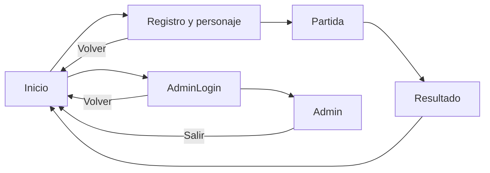

# S3-07 · diagnóstico de interfaz principal y pantallas

Proyecto Life Drive · Unity 6000.6.7f1 · rama feat/unity-map. Raíz confirmada: Life-Drive; no Life-Drive/game.

## Conclusión

**Hay seis controladores de pantallas del producto, pero no hay escenas de producto montadas en este checkout.** Solo se encontraron DemoRecorrido y DemoInterfazPartida. Por tanto, existe lógica de interfaz reutilizable de Javier, y existen demostraciones visuales funcionales, pero no se puede declarar completo un flujo Inicio→Registro→Partida→Resultado ni la administración.

La selección de personaje ya forma parte del registro: no tiene una escena ni controlador separados. Las pantallas faltantes necesitan diseño, montaje de objetos y referencias. La partida, además, necesita contratos de integración para conectar el movimiento y los indicadores propios al motor sin usar datos ficticios como datos reales.

Esta revisión es de solo lectura, salvo este documento y su metadato. No se entró a Play Mode, no se abrieron otras escenas, no se ejecutaron servicios, no se accedió a credenciales ni a datos de jugadores y no se alteró la gamificación.

## Método y alcance de la evidencia

Se leyeron los seis scripts solicitados de Assets/Scripts/UI y Motor/Sesion.cs, las dos escenas serializadas, ruta.json y los documentos DemoInterfazPartidaGuide.md, GamificacionS3-04.md y AnalisisIntegracion.md. Se consultaron en modo lectura BotonesLista, ServicioUsuarios, ServicioDesempeno, Roles y Validacion para comprobar dependencias y comportamiento.

El inventario por archivos se contrastó mediante Unity MCP con AssetDatabase: **dos escenas y cero prefabs bajo Assets**. Unity informa 6000.6.7f1, modo edición, sin compilación activa, escena DemoInterfazPartida abierta y sin cambios pendientes. No hay componentes LifeDrive.UI en la escena cargada. La serialización de ambas escenas confirma que sus scripts propios son los de las demostraciones; no contienen los controladores PantallaInicio/Registro/Partida/Resultado/AdminLogin/Admin.

“Implementado en script” no significa “probado como pantalla montada”. Las pruebas previas de las demos constan en sus guías; no se repitieron en esta etapa. Console, consultada sin borrarla, no mostró errores ni advertencias. No se requirió una compilación nueva porque no se cambió código.

## Inventario de escenas y navegación

| Archivo existente | Tipo | Función y estado |
|---|---|---|
| Assets/Scenes/DemoRecorrido.unity | Demostración independiente | Movimiento por mapa único o por ocho recorridos visuales completos, selección de mapa/ruta, pausa, velocidad, carril, fundidos y llegada. Sin motor de partidas. |
| Assets/Scenes/DemoInterfazPartida.unity | Demostración independiente | Maqueta de partida, tres situaciones ficticias, clics, retroalimentación, puntos/progreso/insignias simulados. Recursos y movimiento reutilizables; no es la escena Partida del producto. |

No aparecieron otras escenas bajo Assets, tampoco con otros nombres o fuera de Assets/Scenes. Ambas demos tienen cámara, luz y un objeto controlador propio. La interfaz de la demo usa IMGUI; no es un Canvas/prefab listo para asignar a los campos de los controladores uGUI/TextMeshPro del producto.

Motor/Sesion.cs declara seis nombres de escena: **Inicio, Registro, Partida, Resultado, AdminLogin y Admin**. Ningún archivo con esos nombres fue encontrado. EditorBuildSettings.asset referencia únicamente **Assets/Scenes/SampleScene.unity**, que tampoco existe en el inventario. Ninguna de las demos está incluida allí. No se encontraron assets de Build Profile en Assets que aporten otra lista de escenas; cualquier configuración externa o de otro equipo queda por confirmar.

Esta discrepancia impide considerar lista la navegación basada en SceneManager.LoadScene(Escenas.*). No se corrigió la lista ni se sustituyeron las escenas por demos. Antes de crear archivos canónicos conviene coordinar con Javier si sus escenas/prefabs existen en otra rama o aún no se han compartido; su ausencia aquí no demuestra que nunca se hayan creado en otro lugar.

### Pantallas requeridas

| Experiencia | Script existente | Escena propia encontrada | Estado real |
|---|---|---|---|
| Inicio | PantallaInicio.cs | No | Eventos y carga/validación de servicios escritos; falta pantalla visual montada. |
| Registro de jugador | PantallaRegistro.cs | No | Formulario y llamada al registro escritos; faltan controles, referencias y diseño. |
| Selección de personaje | Incluida en PantallaRegistro.cs | No, ni independiente ni Registro | Generación de botones por nombre y selección de ID; sin tarjetas descriptivas o retratos. |
| Partida | PantallaPartida.cs | No | Situación/consecuencia y llamadas al motor escritas. DemoInterfazPartida es una referencia visual separada, no su implementación integrada. |
| Resultado | PantallaResultado.cs | No | Resumen de desempeño escrito; falta escena y diseño. No hay tres categorías de final. |
| Inicio de sesión de administrador | PantallaAdminLogin.cs | No | Validación por servicio y navegación escritas; falta montaje visual. |
| Panel de administrador | PantallaAdmin.cs | No | Búsqueda, listado, eventos y generación de PDF escritos; falta montaje y comprobación del flujo. |

Hay siete experiencias, no siete controladores: personaje y registro comparten controlador. No hay necesidad técnica confirmada de crear una séptima escena para personajes.

## Responsabilidades y requisitos de cada controlador

Todas las rutas de esta sección son Assets/Scripts/UI/*.cs. Sus campos SerializeField requieren referencias de Inspector; no crean por sí mismos el árbol de objetos de una pantalla.

### PantallaInicio

- Enlaza Jugar con Registro y Administrador con AdminLogin.
- Llama Sesion.Cerrar y fuerza la inicialización/carga de Sesion.Juego; muestra ErrorJuego y desactiva ambos accesos si falla.
- Requiere botonJugar, botonAdministrador y textoMensaje.
- Falta escena, composición, identidad visual, botones y zona visible para fallos de contenido/base local. No hay título, tutorial o botón Salir implementados en este script; si se desean, son alcance adicional por acordar.

La apertura de Inicio no es una operación puramente visual: puede abrir la base local y cerrar/registrar una sesión previa. Por eso no se ejecutó para comprobar el diseño durante este diagnóstico.

### PantallaRegistro y selección de personaje

- Requiere campos de nombre/cédula, contenedorPersonajes, prefabBoton, Iniciar, Volver y textoMensaje.
- Crea un botón por personaje leyendo Sesion.Juego.Contenido.personajes. El clic guarda personajeId y deshabilita el botón elegido como indicación de selección; no hay campo público de selección ni callback de retrato.
- RegistrarJugador recibe texto de nombre y cédula más el ID; si tiene éxito carga Partida. Volver carga Inicio.
- La validación disponible exige nombre no vacío, cédula de 5–15 dígitos sin puntos/letras y personaje válido. El backend local también comprueba el personaje y la identidad del registro. El comentario de Validacion sobre “servidor” no describe la arquitectura actual, que es local.
- BotonesLista solo rellena un TMP_Text con p.nombre. La descripción del personaje no se muestra y el script no asocia retratos por ID.

Se puede montar un formulario y botones estilizados conservando estas llamadas. Para tarjetas con descripción/retrato distinto por personaje o una escena separada de selección, se necesita un enlace de datos explícito coordinado con Javier; cambiar el aspecto del prefab compartido por sí solo no hace ese binding. No usar reflection ni inferir la selección desde textos o el orden de los objetos.

UX a acordar: el servicio permite reingresar con la misma cédula y nombre; si el jugador ya existe, conserva su personaje guardado y no lo cambia por la nueva selección del formulario. Presentar una “edición de personaje” sin ese contrato daría una confirmación engañosa. No hay un flujo de contraseña de jugador que deba añadirse por iniciativa propia.

### PantallaPartida

- Requiere barra con nombre, puntos y tramo; panel de situación con tipo, enunciado, contenedor de alternativas y prefabBoton; panel de consecuencia con veredicto, explicación, distintivo de buena práctica y Continuar; textoError.
- Comprueba Rol.Jugador, inicia o retoma mediante Partidas.IniciarPartida, guarda Sesion.PartidaId y consulta SituacionActual.
- Genera alternativas por clic. Decidir llama al servicio y muestra el ResultadoDecision confirmado. Continuar consulta la siguiente situación o carga Resultado cuando obtiene null.
- Ya muestra puntos reales acumulados y delta con signo en la consecuencia. Ya existe un distintivo momentáneo para es_buena_practica: no equivale a un catálogo persistente de las tres insignias simuladas.
- No contiene reproducción del camión, progreso físico, progreso educativo completo, panel de insignias ni pausa de animación. Sus métodos de flujo son privados y no exponen eventos de sincronización.

Faltan tanto escena/diseño como integración. No basta asignarle el fondo y copiar el HUD de la demo: ServicioPartidas avanza antes de retornar, hay que esperar la animación antes de mostrar la siguiente situación y el salto final a Resultado debe coordinarse con DELIVERY.

### PantallaResultado

- Requiere textoPuntos, textoDetalle, textoRuta y botonSalir.
- Si no hay Sesion.PartidaId vuelve a Inicio; consulta Desempeno.Resumen y muestra puntos, preguntas, decisiones, riesgos, buenas prácticas, retraso e itinerario.
- Salir cierra la sesión y carga Inicio.
- Falta escena y jerarquía visual del resumen, con espacio para recorridos largos y texto variable. El código no define victoria/derrota ni tres categorías de final; no diseñar etiquetas de resultado que las inventen.

No ofrece todavía “jugar de nuevo”, elección de otra partida o PDF para el jugador. El PDF administrativo no se debe habilitar al jugador solo por reutilizar un botón.

### PantallaAdminLogin

- Requiere usuario, contraseña, Ingresar, Volver y textoMensaje; contraseña configurada como Password.
- Llama Usuarios.IniciarSesionAdministrador y carga Admin si funciona. En ErrorJuego limpia contraseña y muestra el mensaje. Volver carga Inicio.
- No ofrece autorregistro; las cuentas se administran mediante la herramienta de Editor existente. No se inspeccionaron credenciales ni se intentó iniciar sesión.
- Falta escena, formulario y estados visuales de error/foco. No hace falta reescribir autenticación para diseñarla.

### PantallaAdmin

- Requiere búsqueda, Buscar, contenedores de jugadores y partidas, prefabBoton, Salir, textoMensaje y textoEventos.
- Comprueba Rol.Administrador; si no lo es, redirige a AdminLogin. Usa ListarJugadores, PartidasDe y Eventos del servicio de desempeño.
- Muestra nombre/cédula/cantidad de partidas; al seleccionar jugador lista únicamente partidas finalizadas, aunque la consulta del servicio devuelva todas. Muestra hasta 15 eventos de ese jugador.
- “Ver desempeño” genera el PDF mediante ReportePdf, escribe el archivo en CarpetaReportes y lo abre con el visor del sistema. No hay una pantalla interna de detalle de desempeño implementada por este controlador.
- Salir cierra sesión y vuelve a Inicio. Ya hay mensajes de listas vacías y algunos errores de reporte.

Falta escena, distribución, listas desplazables y legibles, selección visible y tratamiento de eventos largos. El prefab de botón esperado no existe bajo Assets. La exportación debe probarse después con datos autorizados de prueba: escribe un PDF y un evento de reporte, por lo que no se ejecutó en este análisis. No confundir “Ver desempeño” con una consulta que no produce efectos de escritura.

## Cuatro personajes disponibles

Datos leídos de Assets/StreamingAssets/Contenido/ruta.json, sin modificación:

| ID real de personaje | Nombre | Descripción existente |
|---|---|---|
| 1 | Andrés | Conductor con 10 años en carretera |
| 2 | Camila | Conductora de tractocamión |
| 3 | Miguel | Conductor de carga refrigerada |
| 4 | Valentina | Conductora de carga seca |

Son IDs de personaje, no de mapas o tramos. No hay campos de sprite/retrato en esos datos ni se encontraron retratos de estos personajes entre los recursos gráficos de Assets. Los PNG inventariados corresponden a fondos, miniaturas y camión; no se encontraron fuentes TTF/OTF o prefabs de tarjetas en Assets. Las fuentes y controles suministrados por paquetes Unity no equivalen a recursos de personaje ya diseñados.

Recomendación: conservar los cuatro IDs y textos y empezar con tarjetas accesibles de nombre/descripción, marco de selección y un placeholder claramente marcado mientras no exista arte aprobado. No inventar estadísticas, ventajas de conducción, género adicional, experiencia distinta o efectos sobre puntuación. No generar retratos en esta etapa.

## Diseño visual frente a configuración e integración

| Pantalla | Trabajo visual pendiente | Configuración reutilizando código | Integración o cambio de contrato |
|---|---|---|---|
| Inicio | Diseño y montaje completos | Asignar dos botones y mensaje; probar destinos | Acordar nombres/escenas e inicialización; sin necesidad inicial de cambiar negocio |
| Registro/personaje | Formulario y selección legible | Campos, botones, contenedor, prefab Button/TMP y errores | Binding de descripción/retrato, selección separada o cambio de personaje existente |
| Partida | Llevar lenguaje de la demo a presentación de producto | Paneles y alternativas del controlador existente | Hooks de espera, fondo correcto, pausa, progreso, insignias y llegada; principal bloqueo |
| Resultado | Resumen claro y adaptable | Textos y Salir con Resumen existente | Navegación tras llegada y cualquier categoría de final o acción nueva |
| AdminLogin | Formulario con foco y errores | Campos Password/usuario y botones | Solo si se cambia flujo de acceso; no crear autenticación paralela |
| Admin | Listas y eventos con jerarquía y desplazamiento | Contenedores, filas/botones y mensajes | Detalle interno adicional, nuevos filtros, paginación o cambio de exportación |

Ninguna escena de producto está actualmente en el estado “solo falta conectar una referencia”. En Inicio, Registro básico, Resultado básico y AdminLogin, gran parte del código puede conservarse y el esfuerzo principal es diseño/montaje/configuración; aun así falta crear la escena y comprobarla. Partida exige además trabajo coordinado de integración. El panel administrativo ya tiene operaciones, pero no una interfaz montada.

## Estética común propuesta

- Mantener el lenguaje de Life Drive: paneles azul oscuro, texto marfil, acentos verde agua y dorado, bordes rectos y detalles pixelados discretos. Usar texto/forma además de color para selección, error e insignia bloqueada.
- Reutilizar fondos aprobados como recursos separados de la UI, con proporción 16:9 y Point; no pintar títulos, personajes o botones dentro de los PNG. Un menú puede usar una composición propia con el fondo existente, sin implicar una asociación lógica de tramo.
- Reservar el mapa para observar carretera y camión; situaciones en panel lateral o modal acotado, sin ocultar por defecto la curva que debe revisarse. Mantener HUD de puntos, trayecto y situaciones diferenciados.
- Botones grandes con foco, estado pulsado/deshabilitado y etiquetas de acción. Campos con etiqueta persistente, no solo placeholder; mensajes junto al formulario. Diseño con ratón y navegación de formularios, sin convertir teclas de foco en conducción manual.
- En registro, presentar las cuatro opciones como un conjunto con selección explícita. En resultado y administración, priorizar lectura de datos sobre decoración.
- Mantener estilo pixel art en marcos e iconos sin sacrificar tipografía: la demo usa fuente estándar; una futura fuente pixelada debe probar tildes, ñ, signos, tamaños y legibilidad. No se ha seleccionado ni instalado una fuente nueva.
- La demo usa un lienzo lógico proporcional de 1600×900; el producto debería revisar CanvasScaler, anclajes, zonas seguras, listas y textos variables en varios tamaños de ventana. No convertir el escalado IMGUI actual en garantía de adaptación móvil.

## Componentes reutilizables de nuestras demos

| Recurso/componente | Reutilización viable | Límite |
|---|---|---|
| 16 MapaVisual, fondos y miniaturas | Presentación de mapas, selección y herramientas de revisión | Sin asociaciones aprobadas con los cuatro tramos lógicos |
| CamionCarga y RecorridoDemo | Sprite, trayectoria por longitud, tangente y carril provisional | Escala y cabida física siguen sin certificación |
| DemoRecorrido | Movimiento, fundidos, pausa y área visual externa | Mantener herramientas de prueba separadas del flujo real; no elegir una ruta educativa completa por adelantado |
| Estilos de DemoInterfazPartida | Jerarquía mapa/panel, contraste, botones y mensajes | Código IMGUI, no prefab uGUI intercambiable con Button/TMP de Javier |
| Indicador de puntos y explicación de delta | Mostrar un resultado confirmado con signo y explicación | No usar valores o reglas ficticias para alimentar una partida real |
| Barra de trayecto y contador de situaciones | Separar desplazamiento y respuestas completadas | Definir denominador real y progreso de reanudación; 3 situaciones y máximo histórico son reglas de demo |
| Panel e iconos de insignias | Apariencia bloqueada/desbloqueada y notificaciones | Señales demo.* y condiciones no autorizadas para eventos reales; no hay persistencia real |
| ResultadoPresentacionDemo / estado temporal | Referencia de separación de datos, presentación e idempotencia | Acordar contrato de adaptador; no sustituir Evaluacion/ServicioPartidas |

La gamificación S3-04 conserva su valor como prototipo funcional. No hay que reescribirla ni alterarla para diagnosticar pantallas. El distintivo de buena práctica existente en PantallaPartida puede compartir lenguaje visual, pero su semántica no es idéntica a las tres insignias de prueba.

## Dependencias entre pantallas y motor

Flujo definido en código, aún no verificado entre escenas reales:

- Sesion.Juego crea ServicioJuego una vez y usa StreamingAssets/Contenido más Application.persistentDataPath. ServicioJuego conecta Contenido, usuarios, partidas, desempeño y registro local.
- Inicio inicializa; Registro establece usuario; Partida exige jugador e inicia/retoma; Resultado usa Sesion.PartidaId y acceso al resumen propio; Admin exige administrador y permisos de consultas/reportes. Ocultar un botón no reemplaza estos controles del servicio.
- IniciarPartida y Decidir escriben progreso y eventos. IniciarSesionAdministrador también registra intentos; ReportePdf registra exportación. No son acciones para probar informalmente en una auditoría de solo lectura.
- El motor tiene tres recorridos con convergencias; el árbol visual tiene ocho. No existen correspondencias numérico-visuales confirmadas y ServicioPartidas puede avanzar antes de devolver una decisión. La UI debe representar hechos confirmados sin reenviar la decisión al acabar una animación.
- La reanudación guarda estado lógico, no fondo/distancia/fundido. Tampoco existen las tres categorías de final o reconocimientos reales persistidos. Estos pendientes no se resuelven asignando un Canvas.
- Los métodos privados de PantallaPartida no ofrecen callbacks para las esperas. Se requieren puntos de extensión coordinados, no vigilancia de textos o acceso a campos privados desde la nueva presentación.

Actualización respecto al documento de integración: la demo ya dispone de PosicionarProgreso y un anfitrión externo de presentación desde la etapa posterior de interfaz. Esa API sirve para la prueba visual, pero no crea por sí misma checkpoints ni reanudación real. Las incompatibilidades de grafos y contratos descritas en AnalisisIntegracion.md siguen vigentes.

## Qué puede realizar Sofía y qué requiere coordinación

**Trabajo independiente futuro, una vez autorizada la implementación:** diseñar composiciones y tokens visuales; crear recursos propios de marcos, botones, tarjetas y estados; preparar prefabs uGUI/TMP compatibles con los campos existentes; diseñar escenas prototipo en espacios propios; revisar tamaños, lectura y mensajes con datos ficticios; preparar un inventario de referencias sin modificar servicios ni decisiones. Todo ello manteniendo las demos funcionales separadas.

**Coordinación con Javier/equipo:** confirmar si faltan escenas por compartir; acordar quién crea las escenas canónicas y los nombres Escenas.*; aprobar la incorporación a Build Profiles/Settings; enlazar controladores y datos reales; modificar hooks o métodos de UI; tarjetas de personaje con nuevo binding; política de personaje al reingresar; manejo de carga/errores; comandos visuales, historial y checkpoint; reglas reales de puntos/insignias y finales; permisos de acciones administrativas y comportamiento de exportación.

No duplicar PantallaInicio/Registro/etc. bajo otro nombre para competir con el código existente. Si se propone un presentador nuevo o una reorganización de vistas, debe estar explícitamente acordado. La escena de demostración nunca debe renombrarse Partida para aparentar integración.

## Plan concreto de implementación por prioridad

| Orden | Entrega propuesta | Criterio de aceptación | Dependencia |
|---|---|---|---|
| 0 | Confirmar escenas/prefabs pendientes del equipo y matriz de campos | Una única lista de responsables, nombres y destinos; sin sobrescribir trabajo de Javier | Coordinación inicial |
| 1 | Sistema visual mínimo y prototipo de Inicio | Jugar/Administración distinguibles, errores legibles, sin servicio paralelo | Recursos propios; luego configurar controlador existente |
| 2 | Registro con selección de cuatro personajes en la misma experiencia | Los cuatro IDs se conservan; selección visible; campos/errores; arte ausente marcado placeholder | Registro existente; acordar binding de tarjetas |
| 3 | Vista de Partida con situación y consecuencia | Botones, HUD y pausa visual coherentes; un resultado confirmado no se aplica dos veces | Contrato de integración y asociaciones aprobadas antes de conectar motor |
| 4 | Resultado del jugador | Resumen legible a partir de Resumen; Salir claro; sin categorías inventadas | Sesion.PartidaId y secuencia de llegada acordada |
| 5 | AdminLogin | Usuario/contraseña, volver, errores y foco correctos | Autenticación existente, cuentas de prueba autorizadas |
| 6 | Panel Admin | Búsqueda, listas, selección, vacíos, eventos y acción PDF claramente identificada | Servicios y permisos existentes; acordar detalle/exportación |
| 7 | Integración de navegación y verificación completa | Escenas reales incluidas en configuración aprobada, referencias completas y pruebas de extremo a extremo | Coordinación; no realizada en este diagnóstico |

Para cada escena montada: cámara/configuración de render apropiada, Canvas, CanvasScaler, EventSystem y módulo de entrada compatible con la configuración del proyecto, fuentes/materiales TMP disponibles, referencias asignadas y botones dinámicos con TMP_Text hijo. Validar esos elementos en Editor antes de atribuir un fallo al servicio. El proyecto no contiene hoy el prefab Button esperado por BotonesLista.

Pruebas de aceptación futuras: navegación jugador completa; registro nuevo y reingreso con identidad ficticia; cuatro selecciones; errores de formulario; situaciones/consecuencias con clics repetidos; pausa/reanudación/transición/entrega; resumen propio; rechazo por rol; login administrativo inválido/válido; búsquedas sin filas; jugador sin partidas finalizadas; eventos largos; generación/fallo de PDF y retorno. Usar base aislada de prueba y no la información real del usuario. Estas pruebas no se ejecutaron en esta etapa.

## Riesgos y decisiones pendientes

| Riesgo | Implicación y tratamiento recomendado |
|---|---|
| Scripts confundidos con pantallas terminadas | Mantener separados estado de código, escena, referencias y prueba funcional. |
| SampleScene ausente y destinos no registrados | Navegación no lista para producto; acordar escenas y configuración antes de probar flujo completo. |
| Referencias SerializeField sin objetos | NullReference al iniciar; checklist por controlador, no reescritura de motor. |
| Ausencia de prefab dinámico y Canvas | Las alternativas/personajes/listas no aparecen por existir el script; montar recursos compatibles. |
| IMGUI y uGUI superpuestos | La demo no es una pantalla asignable; separar reproductor y vista de producto para evitar dobles HUD o controles. |
| Partida lógica adelantada y convergencias | Cola de presentación y acuerdos de mapping; no elegir mapas por parecido de nombres. |
| Gamificación simulada presentada como real | Mantener demo.* aislado y definir adaptador/reglas aprobadas antes de cambiar etiquetas. |
| Personaje existente distinto al seleccionado | Mostrar comportamiento real o acordar cambio; no confirmar una actualización que el servicio no realiza. |
| Mensajes largos, cuatro personajes y muchas partidas | Anclajes, scroll y tamaños de texto; comprobar ventanas pequeñas y tildes. |
| Falta de captura uniforme de errores | Algunos Start/consultas quedan fuera de try/catch; revisar manejo de fallos con Javier, sin parchear sus scripts aquí. |
| PDF y cierre/login con efectos persistentes | Probar en base aislada y declarar la acción; no confundir diagnóstico con operación real. |
| Resultado confundido con categoría de final | Presentar métricas actuales, no asignar victoria/derrota por carretera o puntaje arbitrario. |

## Recomendaciones para S3-07 y S3-08

Para **S3-07**, concentrar el esfuerzo en convertir el código disponible en experiencias visuales montadas, empezando por Inicio y Registro/personajes, después Partida y Resultado, y finalmente Administración. Reutilizar recursos de S3-04 sin conectar sus reglas ficticias al motor. El criterio de cierre debería distinguir “diseño aprobado”, “escena configurada” e “integración probada”; las demos existentes solo cubren la presentación de prueba.

No se proporcionó en esta solicitud el título, alcance ni responsable de **S3-08**, y no se encontró una definición del cronograma en los archivos locales revisados. No se le asigna una actividad inventada. Como recomendación de continuidad, si S3-08 contempla integración o validación de pantallas, reservarla para contratos con Javier, navegación, reanudación, regresión y revisión de usabilidad, una vez montadas las vistas. Confirmar su alcance en el cronograma antes de convertir esta recomendación en tareas o fechas. No se amplía el trabajo a actividades cuyo responsable principal no sea Sofía o Todos.

## Archivos y cierre de esta etapa

Únicos archivos creados: Assets/Mapas/DiagnosticoPantallasS3-07.md y su `.meta`. No se modifican scripts, contenido, escenas, recursos o gamificación. No se implementan pantallas. No se hace commit ni push. El estado funcional del producto se informa como pendiente de montaje/integración; no se afirma una prueba de pantallas inexistentes.

Comprobación de integridad: los 264 archivos existentes capturados antes de la documentación, dentro de Scripts, Scenes, StreamingAssets, Mapas y ProjectSettings, conservaron sus hashes SHA-256. Los cambios locales previos se mantuvieron.
