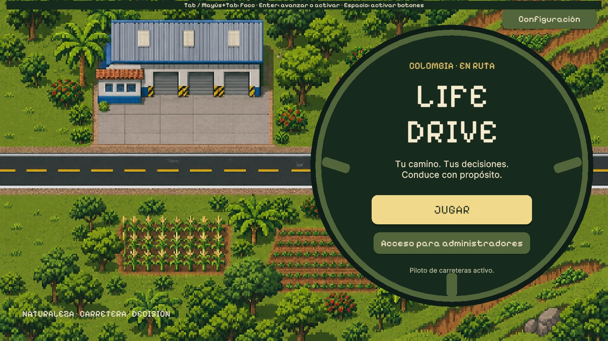
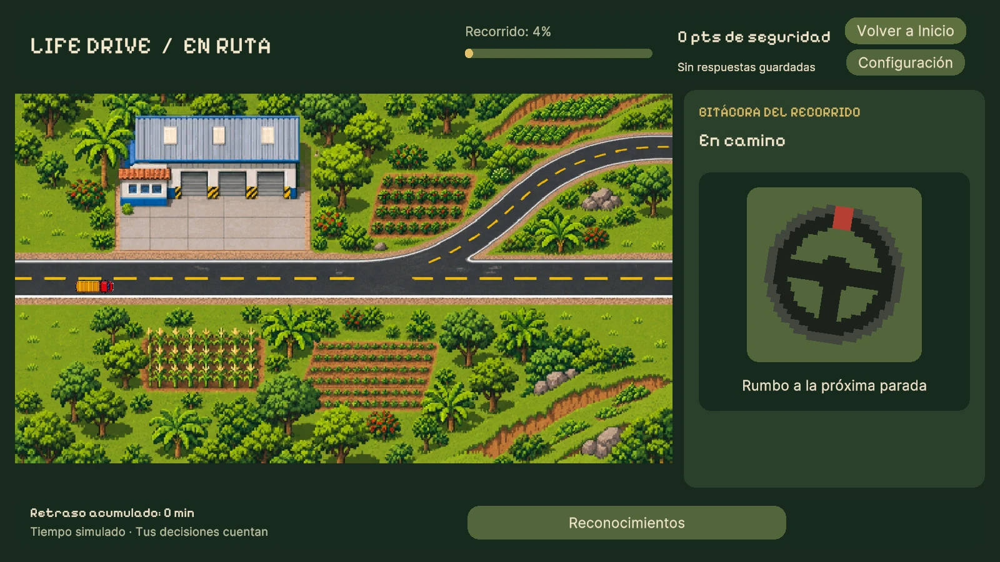
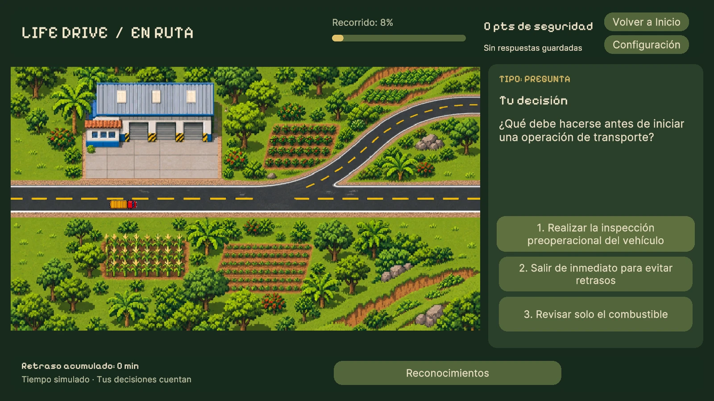
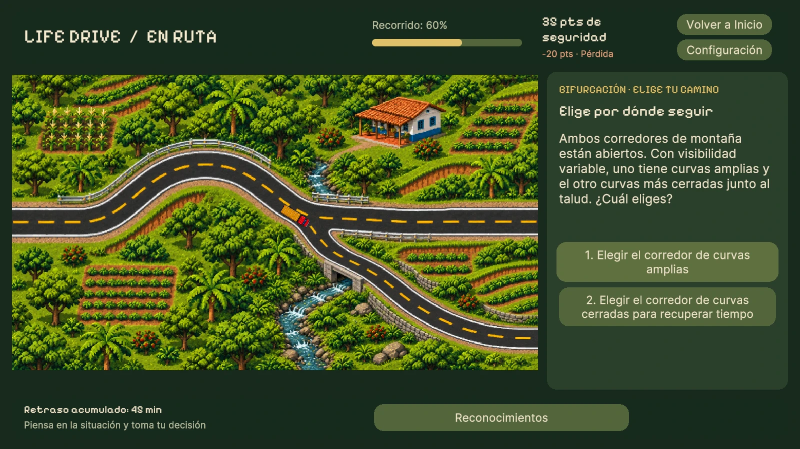
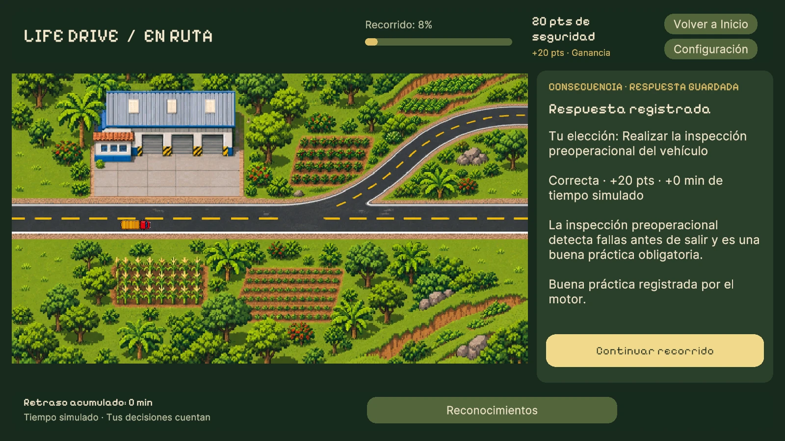
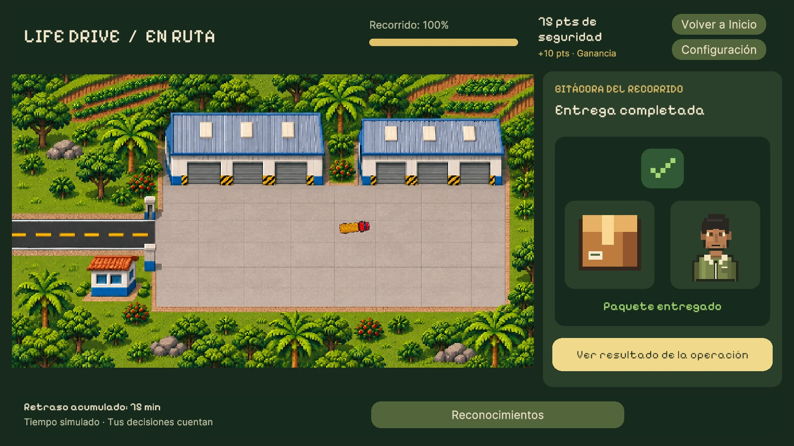
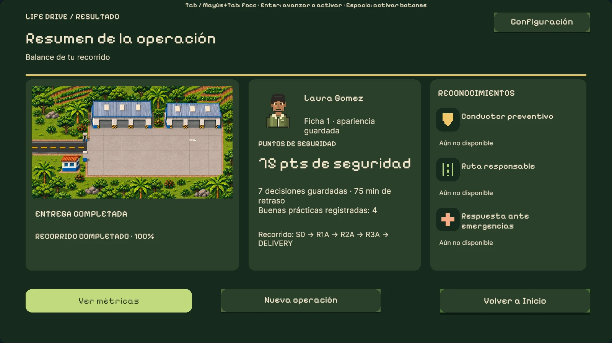
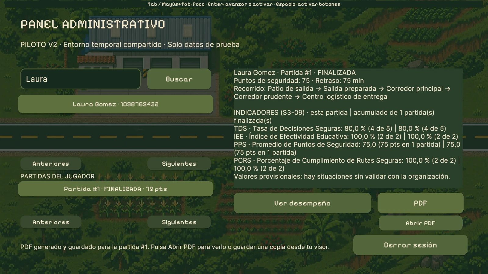

<div align="center">

# 🚚 Life Drive

**Tu camino. Tus decisiones. Conduce con propósito.**

Juego serio educativo para conductores de transporte de carga en Colombia.

[](https://lifedrive.javier.life)




</div>

---

## Tabla de contenido

- [Sobre el juego](#sobre-el-juego)
- [Objetivo](#objetivo)
- [Capturas](#capturas)
- [Cómo se juega](#cómo-se-juega)
- [Situaciones del recorrido](#situaciones-del-recorrido)
- [Reglas y puntuación](#reglas-y-puntuación)
- [Resultado e indicadores de desempeño](#resultado-e-indicadores-de-desempeño)
- [Perfiles](#perfiles)
- [Tecnología](#tecnología)
- [Estructura del proyecto](#estructura-del-proyecto)
- [Cómo ejecutar el proyecto](#cómo-ejecutar-el-proyecto)
- [Equipo](#equipo)

---

## Sobre el juego

**Life Drive** pone al jugador en la cabina de un conductor de transporte de carga que debe llevar una operación desde el **punto de salida** hasta el **centro logístico de entrega**. En el camino aparecen preguntas, riesgos, emergencias y bifurcaciones: cada respuesta tiene una consecuencia y algunas decisiones **cambian la ruta**.

El paisaje reacciona a lo que el jugador hace. Las decisiones inseguras deterioran el entorno y las decisiones seguras lo recuperan, así que el recorrido de cada persona puede ser distinto.

> **Llegar más rápido no significa obtener el mejor resultado:** lo que cuenta es qué tan seguro fue el recorrido.

## Objetivo

Fortalecer la capacidad de los conductores para **identificar situaciones de riesgo y tomar decisiones seguras** durante una operación de transporte. El juego trabaja estos temas:

| | | |
|---|---|---|
| 🛣️ Seguridad vial | 📦 Manejo de cargas | ⚠️ Prevención de accidentes |
| 🔧 Mantenimiento | 🚨 Protocolos de emergencia | 😴 Fatiga y pausas |
| 🌱 Medio ambiente | 📋 Normas y procedimientos de la empresa | |

## Capturas

<table>
  <tr>
    <td width="50%"><br><sub><b>Registro.</b> El jugador ingresa sus datos y personaliza su conductor.</sub></td>
    <td width="50%"><br><sub><b>En ruta.</b> Una pregunta de conocimiento antes de salir del patio.</sub></td>
  </tr>
  <tr>
    <td><br><sub><b>Bifurcación.</b> El jugador elige por cuál corredor continuar.</sub></td>
    <td><br><sub><b>Consecuencia.</b> Cada decisión muestra sus puntos, el retraso y una explicación.</sub></td>
  </tr>
  <tr>
    <td><br><sub><b>Entrega.</b> El paquete llega al centro logístico.</sub></td>
    <td><br><sub><b>Resultado.</b> Balance completo del recorrido y reconocimientos.</sub></td>
  </tr>
  <tr>
    <td colspan="2" align="center"><br><sub><b>Panel administrativo.</b> Consulta del desempeño por partida, indicadores y reporte PDF.</sub></td>
  </tr>
</table>

## Cómo se juega

1. Elige **Jugar**, escribe tu nombre y tu número de documento y personaliza tu conductor.
2. La operación comienza en el patio de salida.
3. El camión avanza por la ruta hasta encontrar una situación.
4. Elige una de las alternativas.
5. El juego muestra la consecuencia: si fue segura o insegura, los puntos ganados o perdidos, el retraso y, si cambió, el nuevo camino.
6. Los puntos de seguridad se actualizan y el recorrido continúa.
7. El ciclo se repite hasta llegar al destino final.

Si cierras el juego a mitad de camino, al volver retomas la partida donde la dejaste.

**Controles:** ratón, o teclado completo (`Tab` / `Mayús+Tab` para moverse, `Enter` o `Espacio` para elegir, `RePág` / `AvPág` para leer textos largos).

## Situaciones del recorrido

| Tipo | Qué pasa |
|---|---|
| **Pregunta de conocimiento** | Evalúa un concepto de seguridad o un procedimiento. Siempre muestra la explicación de la respuesta correcta. |
| **Bifurcación** | Ofrece dos o más caminos; la opción elegida lleva al jugador por una ruta distinta. |
| **Riesgo** | Una condición que puede afectar el recorrido, como la fatiga o la presión por cumplir un horario. |
| **Emergencia** | Una situación inesperada, como una falla mecánica, que exige elegir cómo actuar. |
| **Buena práctica** | Las decisiones preventivas (hacer una pausa, la inspección preoperacional, reportar un retraso) reciben un distintivo especial. |

## Reglas y puntuación

1. El jugador inicia la operación desde el punto de salida y avanza hasta el destino.
2. En el recorrido aparecen preguntas, riesgos, emergencias y puntos de decisión.
3. Algunas decisiones solo cambian la puntuación; otras cambian el camino.
4. Cada camino presenta situaciones diferentes, así que dos jugadores pueden tener recorridos distintos.
5. Las decisiones seguras dan puntos; las inseguras pueden quitar puntos o agregar retrasos.
6. Todos los caminos llegan al destino.

| Acción | Puntos de seguridad |
|---|:---:|
| Respuesta correcta | **+10** |
| Decisión segura | **+15** |
| Buena práctica | **+20** |
| Decisión insegura | **−20** |

> Los valores son provisionales y están pendientes de validar con la organización.

## Resultado e indicadores de desempeño

Al llegar al destino, el jugador ve un resumen de toda la operación, no solo su puntaje: puntos de seguridad, retraso acumulado, decisiones guardadas, buenas prácticas, reconocimientos y la ruta recorrida.

El administrador consulta, para cada partida y de forma acumulada por jugador, cuatro indicadores:

| Indicador | Qué mide |
|---|---|
| **TDS** · Tasa de Decisiones Seguras | Porcentaje de decisiones seguras ante riesgos, emergencias y bifurcaciones. |
| **IEE** · Índice de Efectividad Educativa | Porcentaje de preguntas de conocimiento respondidas correctamente. |
| **PPS** · Promedio de Puntos de Seguridad | Puntos de seguridad promedio por partida finalizada. |
| **PCRS** · Cumplimiento de Rutas Seguras | Porcentaje de bifurcaciones en las que se eligió el camino seguro. |

Ese resultado se exporta como **reporte PDF** (desde el panel administrativo; en la versión web se descarga en el navegador).

## Perfiles

| Perfil | Cómo entra | Qué hace |
|---|---|---|
| **Jugador** | Escribe su nombre, su número de documento y personaliza su conductor | Recorre la ruta, responde y decide. Solo ve su propio resultado. |
| **Administrador** | Usuario y contraseña de una cuenta creada previamente | Busca jugadores por nombre o documento, elige una partida finalizada, consulta su desempeño y genera el reporte PDF. |

Las cuentas de administrador **no se crean desde el juego**: se crean en el Editor de Unity (menú **Life Drive › Administradores**) y la contraseña se guarda cifrada con PBKDF2.

## Tecnología

| Área | Detalle |
|---|---|
| Motor | Unity 6 (`6000.6.7f1`) con Universal Render Pipeline |
| Lenguaje | C# |
| Interfaz | uGUI + TextMeshPro, arte pixel art y fuentes pixeladas |
| Entrada | Input System: ratón y navegación completa por teclado |
| Datos | Base de datos local en JSON con transacciones e integridad (tablas jugador, partida, decisión y evento) |
| Reportes | Generador de PDF propio, sin dependencias externas |
| Plataformas | WebGL (navegador) y Windows |
| Pruebas | Unity Test Framework: pruebas EditMode y PlayMode, con medición de cobertura |

**Sobre los datos:** las partidas se guardan en el equipo de cada jugador. En la versión web viven en el almacenamiento del navegador, así que se conservan al recargar la página o al volver otro día desde el mismo navegador.

## Estructura del proyecto

```
Assets/
├── Audio/              Música de fondo
├── Editor/             Herramientas del Editor (compilación web)
├── Mapas/              Fondos de los tramos, bifurcaciones y paisajes deteriorados
├── Plugins/WebGL/      Puente JavaScript (descarga del PDF en el navegador)
├── Scenes/             Cargando, Inicio, Registro, partida, Resultado y administración
├── Scripts/
│   ├── Datos/          Base de datos local, contenido y validaciones
│   ├── Motor/          Reglas del juego, sesiones, indicadores y reportes PDF
│   ├── IntegracionV2/  Flujo del jugador, recorrido, teclado, audio y configuración
│   ├── Mapas/          Catálogo de mapas e interfaz visual
│   └── UI/             Pantallas
├── StreamingAssets/    Contenido de las rutas y cuentas de administrador
├── Tests/              Pruebas EditMode y PlayMode
└── WebGLTemplates/     Página web que contiene el juego
docs/capturas/          Imágenes de este documento
```

## Cómo ejecutar el proyecto

### Jugar

Abre **https://lifedrive.javier.life** en un navegador de escritorio (Chrome, Edge o Firefox). La primera carga descarga unos 40 MB; las siguientes son más rápidas.

### Abrir en Unity

1. Clona el repositorio:
   ```bash
   git clone https://github.com/SofiOyola/Life-Drive.git
   ```
2. Ábrelo con **Unity 6000.6.7f1** desde Unity Hub.
3. Abre la escena `Assets/Scenes/Inicio.unity` y pulsa **Play**.

### Ejecutar las pruebas

En Unity: **Window › General › Test Runner**, pestañas **EditMode** y **PlayMode**.

### Compilar la versión web

Con el módulo **WebGL Build Support** instalado:

```bash
unity build . --target WebGL --execute-method LifeDrive.Editor.ConstructorWeb.Construir --output-path Builds/Web
```

El resultado (`Builds/Web`) es una carpeta estática con `index.html` que se publica tal cual en cualquier servidor web.

## Equipo

Proyecto académico de **Ingeniería de Software II**.

| Integrante | GitHub |
|---|---|
| Sofía Oyola | [@SofiOyola](https://github.com/SofiOyola) |
| Javier Luna | [@JavierLuna242](https://github.com/JavierLuna242) |
| Jorge Luquetta | [@JorgeLuquetta](https://github.com/JorgeLuquetta) |
| Nicolás | [@Nicolas1609-1](https://github.com/Nicolas1609-1) |
